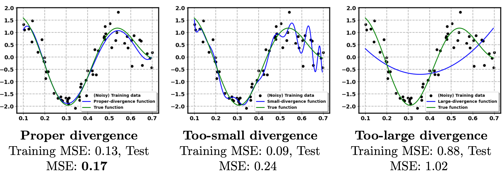
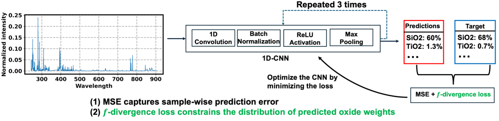

# Regularization via f-Divergence for Multi-Oxide Spectroscopic Analysis

This repository contains the **core algorithmic implementation** for the paper:

**Regularization via f-Divergence: An Application to Multi-Oxide Spectroscopic Analysis**  
Weizhi Li, Natalie Klein, Brendan Gifford, Elizabeth Sklute, Carey Legett, Samuel M. Clegg  
*Manuscript submitted to JGR: Machine Learning and Computation*  
(arXiv: https://arxiv.org/abs/2502.03755)

---

## Important Notes on Scope and Reproducibility

⚠️ **This repository is not a turnkey reproduction package.**

It provides the **main code implementations** for all methods studied in the paper, but
**does not automatically reproduce the reported numerical results**.

Specifically:

1. **No automated hyperparameter search or validation**  
   - The code implements all regularization approaches (f-divergence, ℓ1, ℓ2, dropout,
     and their combinations), but **does not perform parameter search**.
   - Readers should refer to the **hyperparameter ranges reported in the paper** and
     perform a **validation step** to select optimal parameters
     (e.g., `(w, γ)` for f-divergence regularization).

2. **No independent evaluation module is included**  
   - The repository does **not** include a standalone evaluation pipeline for computing
     RMSE across multiple runs or performing paired statistical tests (e.g., t-tests).
   - Evaluation procedures described in the paper were conducted using **external
     analysis scripts**, which are not part of this codebase.

3. **`main.py` uses fixed configurations**  
   - `main.py` is a unified entry point that implements *all approaches* given
     fixed hyperparameters.
   - It does **not** perform grid search, cross-validation, or automated model selection.

These design choices are intentional and reflect the goal of this repository:
to provide a **clear, minimal, and extensible reference implementation** of the proposed
f-divergence regularization framework.

---

## Overview

This work introduces a **distributional regularization framework based on a specific
f-divergence**, designed to improve neural network generalization for
**multi-target regression under label noise**.

Unlike conventional regularization methods (e.g., ℓ1, ℓ2, dropout), which primarily
constrain network parameters or activations, the proposed approach explicitly
regularizes the **output distribution** of a neural network by enforcing an appropriate
divergence between predicted and target distributions.

<p align="center">
  
</p>

**Figure 1. Motivation for f-divergence regularization (reproduced from the manuscript).**  
A function approximation with an appropriate divergence between predictions and noisy
targets generalizes better than approximations with either too small or too large
divergence. This observation motivates explicitly controlling distributional discrepancy
during neural network training.

<p align="center">
  
</p>

**Figure 2. Training objective with f-divergence regularization (reproduced from the manuscript).**  
The neural network is trained using a standard mean squared error (MSE) loss together
with an auxiliary f-divergence regularization term that constrains the distributional
discrepancy between predictions and targets.

Detailed theoretical formulation, graph-based estimation, and algorithmic implementation
are provided in the accompanying manuscript.

---

## Methods Implemented

This repository includes implementations for:

- Convolutional Neural Networks (CNNs) trained with:
  - No regularization
  - ℓ1 regularization
  - ℓ2 regularization
  - Dropout
  - f-divergence regularization (proposed)
  - ℓ1 + f-divergence
  - ℓ2 + f-divergence
  - Dropout + f-divergence
- Partial Least Squares (PLS) baseline

⚠️ **Performance depends critically on hyperparameter selection**, which must be
performed externally following the protocol described in the paper.

---

## Task Description

- **Problem type**: Multi-target regression  
- **Inputs**: 1D LIBS spectra  
- **Outputs**: Oxide weight percentages (wt.%)

The default configuration predicts **multiple oxides jointly** using a single CNN.
The codebase also supports **single-oxide prediction**, consistent with additional
experiments reported in the paper.

---

## Model Architecture

- 1D Convolutional Neural Network (CNN)
- Three convolutional blocks:
  - Convolution → BatchNorm → ReLU → MaxPooling
- Fully connected regression head
- Optimizer: **Adadelta**
- Loss:
  - Mean Squared Error (MSE)
  - + optional f-divergence regularization

---

## Data

- **ChemCam LIBS data**
  - Fully supported
  - Automatically downloaded and preprocessed
  - Publicly available via the Planetary Data System (PDS)

- **SuperCam LIBS data**
  - Fully supported in code
  - Automatically downloaded and preprocessed
  - Publicly available via the Planetary Data System (PDS)
  - Included to support the experimental settings described in the paper

Note: Although both ChemCam and SuperCam datasets are automatically downloaded by the
code, the numerical results reported in the paper additionally rely on external
validation, hyperparameter selection, and statistical evaluation scripts not included
in this repository.

---

## Repository Structure (Key Files)

- `main.py` – main entry point implementing all methods with fixed parameters
- `methods.py` – training logic and f-divergence regularization
- `Models.py` – CNN architectures
- `BaselineModels.py` – PLS and baseline regressors
- `DataUtils.py` – data loading and train/validation/test splitting
- `Options.py` – command-line configuration
- `Utils.py` – utilities (logging, metrics helpers, random seeds)

---

## Running the Code

```bash
python main.py 
